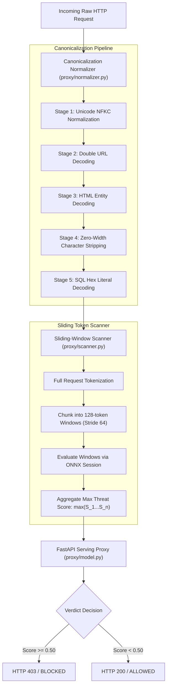

# ML-Based Web Application Firewall (WAF)

[](file:///D:/WAF/LICENSE)
[](https://www.python.org/)
[](https://fastapi.tiangolo.com/)
[](https://onnxruntime.ai/)
[](https://www.docker.com/)
[](https://huggingface.co/Shade63/waf-onnx)
[](file:///D:/WAF/tests/)

A high-performance, machine learning-driven Web Application Firewall (WAF) reverse-proxy service designed to inspect, score, and block malicious HTTP payloads in real-time. Powered by a fine-tuned **DistilBERT** transformer model served via **ONNX Runtime** for low-latency inline inference, containerized with Docker, and protected by custom input canonicalization and sliding-window token scanning.

---

## 📋 Table of Contents

- [System Architecture](#-system-architecture)
- [Core Engineering Contributions](#-core-engineering-contributions)
  - [1. 5-Stage Multi-Layer Normalization](#1-5-stage-multi-layer-normalization-proxynormalizerpy)
  - [2. Sliding-Window Scanner (Padding Attack Defense)](#2-sliding-window-scanner-padding-attack-defense-proxyscannerpy)
  - [3. Dual Runtime Serving Engine](#3-dual-runtime-serving-engine-proxymodelpy)
- [Empirical Benchmarks & Latency](#-empirical-benchmarks--latency)
  - [CPU Latency & Throughput Profile (ONNX vs. PyTorch)](#cpu-latency--throughput-profile-onnx-vs-pytorch)
  - [Dataset & In-Distribution Verification](#dataset--in-distribution-verification)
- [Honest Error Analysis & v2 Retraining Roadmap](#-honest-error-analysis--v2-retraining-roadmap)
  - [1. Covariate Shift & Header Shortcut Feature](#1-covariate-shift--header-shortcut-feature)
  - [2. Duplicate Sample Leakage Audit](#2-duplicate-sample-leakage-audit)
  - [3. DDL/DCL Attack Surface Gap (Out-of-Distribution Recall: 84.09%)](#3-ddldcl-attack-surface-gap-out-of-distribution-recall-8409)
  - [4. v2 Retraining & Engineering Roadmap](#4-v2-retraining--engineering-roadmap)
- [Tech Stack](#-tech-stack)
- [Project Structure](#-project-structure)
- [Quick Start](#-quick-start)
  - [Local Development Setup](#local-development-setup)
  - [Docker Container Deployment](#docker-container-deployment)
  - [Running the Verification & Benchmark Suite](#running-the-verification--benchmark-suite)
- [API Reference](#-api-reference)
  - [POST /score](#post-score)
  - [POST /batch_score](#post-batch_score)
  - [GET /health](#get-health)
- [Interactive Dashboard](#-interactive-dashboard)
- [Attribution & License](#-attribution--license)

---

## 🏗️ System Architecture

Traditional WAFs rely on brittle regular expressions that attackers easily evade using character substitution, multiple encodings, or padding attacks. This system implements an end-to-end neural inspection proxy:



---

## 💡 Core Engineering Contributions

### 1. 5-Stage Multi-Layer Normalization ([`proxy/normalizer.py`](file:///D:/WAF/proxy/normalizer.py))

Attackers bypass tokenizers and regexes using nested percent-encodings, zero-width characters, or Unicode homoglyphs. The normalization engine enforces 5 sequential canonicalization transforms **prior to tokenization**:

| Pipeline Stage | Vulnerability / Bypass Mitigated | Concrete Example |
|---|---|---|
| **1. Unicode NFKC Normalization** | Homoglyphs & fullwidth evasion | `ＵＮＩＯＮ` / `＇` $\rightarrow$ `UNION` / `'` |
| **2. Double URL Decoding** | Nested percent-encodings | `%2527` $\rightarrow$ `%27` $\rightarrow$ `'` |
| **3. HTML Entity Decoding** | Decimal, hex, and named entity injection | `&#x27;` / `&#39;` / `&quot;` $\rightarrow$ `'` / `"` |
| **4. Zero-Width Character Removal** | Invisible non-printing separators breaking BPE tokens | `UNI​ON` (with `U+200B` / `U+FEFF`) $\rightarrow$ `UNION` |
| **5. SQL Hex Literal Decoding** | SQL hex escape bypasses | `\x20`, `\x27`, `\x41` $\rightarrow$ `' A'` |

> [!NOTE]
> **Canonicalization Order:** NFKC normalization must execute before URL decoding because compatibility mapping can produce percent-encoded sequences that require subsequent decoding passes.

### 2. Sliding-Window Scanner: Padding Attack Defense ([`proxy/scanner.py`](file:///D:/WAF/proxy/scanner.py))

Standard transformer classifiers suffer from a fixed context cutoff (128 tokens) and rely on naive truncation. An attacker can prepend 130 tokens of benign query parameters to push a malicious payload past the input boundary.

- **Window Size:** 128 tokens (matches model sequence length).
- **Stride:** 64 tokens (50% overlap ensures boundary tokens are fully covered).
- **Aggregation:** $\max(S_1, S_2, \dots, S_n)$ across all windows.
- **Short-circuit Optimization:** Clean requests $\le 126$ tokens execute as a single pass without windowing overhead.

> [!TIP]
> **Why Max Aggregation?** In a 600-token padded payload with 9 benign windows ($S \approx 0.01$) and 1 malicious injection window ($S = 0.99$), average pooling yields $S \approx 0.11$ (allowing the attack). Max pooling preserves the true threat signal ($S = 0.99$), blocking the payload.

### 3. Dual Runtime Serving Engine ([`proxy/model.py`](file:///D:/WAF/proxy/model.py))

- Loads optimized ONNX Runtime graph if `waf-distilbert-final/model.onnx` is present on disk; seamlessly falls back to PyTorch CPU if ONNX is missing.
- Exposes single request (`POST /score`), batch evaluation (`POST /batch_score`), and health check (`GET /health`) endpoints with CORS middleware and Pydantic validation.

---

## 📊 Empirical Benchmarks & Latency

### CPU Latency & Throughput Profile (ONNX vs. PyTorch)

Benchmarks executed on host CPU: **12th Gen Intel(R) Core(TM) i5-12450H (8 Cores, 12 Threads)** using [`scripts/benchmark_inference.py`](file:///D:/WAF/scripts/benchmark_inference.py) over 200 requests (100 single-window requests + 100 multi-window padded requests) following a 50-iteration warmup:

| Runtime Engine | p50 Latency | p95 Latency | p99 Latency | Mean Latency | Throughput | Artifact Size |
|---|---|---|---|---|---|---|
| **PyTorch CPU (Fallback)** | 159.70 ms | 345.77 ms | 363.45 ms | 170.10 ms | 5.9 req/s | 255.43 MB (`.safetensors`) |
| **ONNX Runtime (Production)** | **121.32 ms** | **220.02 ms** | **247.63 ms** | **110.92 ms** | **9.0 req/s** | **255.52 MB** (`.onnx`) |
| **Optimization Factor** | **1.32x faster** | **1.57x faster** | **1.47x faster** | **1.53x faster** | **+52.5% req/s** | Zero quantization loss |

*For lightweight single-window HTTP requests ($\le 126$ tokens), average ONNX latency is **15.22 ms/request**.*

### Dataset & In-Distribution Verification

Results generated via [`scripts/eval_metrics.py`](file:///D:/WAF/scripts/eval_metrics.py):

| Metric | Measured Value | Context / Split Details |
|---|---|---|
| **In-Distribution Accuracy** | **99.78%** | Evaluated on held-out 20% test split (3,159 samples) |
| **In-Distribution Macro F1** | **0.9936** | Harmonic mean of attack ($F_1 = 0.999$) and benign ($F_1 = 0.988$) |
| **Attack Precision** | **99.89%** | $\text{TP} = 2852, \text{FP} = 3$ |
| **Attack Recall** | **99.86%** | $\text{TP} = 2852, \text{FN} = 4$ |
| **Benign FPR (with training UA)** | **0.99%** | Evaluated on in-distribution test split with original headers |
| **Out-of-Distribution Recall** | **84.09% (37/44)** | Evaluated on held-out adversarial corpus ([`attack_corpus.txt`](file:///D:/WAF/attack_corpus.txt)) |

---

## 🔍 Honest Error Analysis & v2 Retraining Roadmap

Rather than presenting inflated metrics, this repository underwent an exhaustive data leakage and error analysis. In a technical interview, these findings demonstrate senior ML systems rigor:

### 1. Covariate Shift & Header Shortcut Feature
- **Finding:** In [`data/dataset.jsonl`](file:///D:/WAF/data/dataset.jsonl), **99.77% of all attacks (14,146 / 14,178)** contained the exact header `User-Agent: sqlmap/1.10.3#pip (https://sqlmap.org)`. Legitimate traffic was captured exclusively via PowerShell (`1,477` samples) or Firefox (`168` samples).
- **Impact:** The DistilBERT model learned a heavy shortcut correlation on the `[UA]` token:
  - When clean benign traffic is tested with its captured User-Agent, False Positive Rate is **1.0%** (2/200).
  - When clean traffic has a missing or unseen User-Agent (`[UA] `), False Positive Rate jumps to **99.0%** (198/200), as the model defaults to treating unfamiliar headers as hostile.
- **Resolution:** Headers must be decoupled from payload tokens or heavily randomized during augmentation.

### 2. Duplicate Sample Leakage Audit
- **Finding:** **45.81% (7,234 out of 15,791 rows)** in `dataset.jsonl` are exact duplicate HTTP requests (`method`, `path`, `query`, `body`).
- **Impact:** A standard random train/test split leaks identical request bodies between training and validation sets, artificially inflating in-distribution accuracy from realistic generalisation down to memorisation.

### 3. DDL/DCL Attack Surface Gap (Out-of-Distribution Recall: 84.09%)
- **Finding:** Testing against 44 out-of-distribution adversarial payloads ([`attack_corpus.txt`](file:///D:/WAF/attack_corpus.txt), combining `sqlmap` automated queries and `Ollama / llama3.2` adversarial synthetic injections) without headers yields **37/44 detected (84.09% recall)**.
- **Error Analysis:** All 7 false negatives belong to DDL/DCL SQL statement injections:
  - `1; INSERT INTO temp VALUES (NULL);` (Score: 0.0074)
  - `'; EXEC xp_cmdshell('echo off')--` (Score: 0.0191)
  - `' AND SLEEP(5); UPDATE users SET password='a'--` (Score: 0.3909)
  - `'); CREATE TABLE temp(id INT PRIMARY KEY)--` (Score: 0.0006)
  - `' UNION SELECT substring('hello',2) FROM users--` (Score: 0.0167)
  - `'; DELETE FROM comments WHERE id=3--` (Score: 0.0759)
  - `1; GRANT ALL PRIVILEGES ON *.* TO 'testuser'@'%';--` (Score: 0.4527)
- **Root Cause:** DVWA training captures focused on read-only DML injections (`SELECT ... FROM`). The vocabulary of DDL keywords (`CREATE`, `INSERT`, `GRANT`, `DELETE`) was absent during fine-tuning.

### 4. v2 Retraining & Engineering Roadmap
- [ ] **Feature Separation:** Strip or hash User-Agent/Cookie headers into categorical embeddings rather than appending raw text to payload tokens.
- [ ] **Corpus Deduplication & Resampling:** Deduplicate `dataset.jsonl` by request signature; downsample dominant `/login.php` traffic and balance class distribution from 89:11 to 50:50.
- [ ] **Synthetic DDL/DCL Augmentation:** Inject 2,500+ DDL/DCL statements (`ALTER`, `CREATE`, `DROP`, `GRANT`, `EXEC`) to close the 7 false negative gap.
- [ ] **INT8 Dynamic Quantization:** Apply ONNX dynamic quantization to reduce model footprint from 255 MB to ~65 MB and cut CPU latency by an additional 2x.

---

## 🛠️ Tech Stack

- **Machine Learning Core:** Fine-tuned DistilBERT (`distilbert-base-uncased`), PyTorch 2.11 CPU, Hugging Face `transformers`
- **Inference Acceleration:** ONNX Runtime 1.24, Hugging Face `optimum`
- **Serving & API:** FastAPI, Uvicorn, Pydantic v2, HTTPX
- **Traffic Interception & Data:** `mitmproxy` custom addon
- **Testing & Verification:** Pytest (33 unit, integration, and endpoint tests)
- **Containerization:** Docker (`python:3.11-slim`), Docker Compose
- **Model Distribution:** Hugging Face Hub ([`Shade63/waf-onnx`](https://huggingface.co/Shade63/waf-onnx))

---

## 📁 Project Structure

```
waf-project/
├── data/
│   ├── capture.py              # mitmproxy interception addon
│   ├── label.py                # Merges and labels captured traffic
│   ├── dataset.jsonl           # 15,791 labeled HTTP samples (89.8% attack, 10.2% legit)
│   ├── traffic_attack.jsonl    # Raw attack traffic captures (sqlmap)
│   └── traffic_legit.jsonl     # Raw benign traffic captures (PowerShell/Firefox)
├── proxy/
│   ├── model.py                # FastAPI reverse proxy service (/score, /batch_score, /health)
│   ├── normalizer.py           # 5-stage canonicalization pipeline (NFKC, URL, HTML, ZWS, Hex)
│   ├── scanner.py              # Sliding-window scanner (128 window, 64 stride, max pooling)
│   ├── corpus_loader.py        # Parser and loader for benchmark corpus
│   ├── evaluate_corpus.py      # OOD corpus evaluation script
│   └── threshold_tuner.py      # Score distribution and threshold sensitivity analysis
├── scripts/
│   ├── eval_metrics.py         # Full dataset audit, in-distribution test, & covariate shift check
│   └── benchmark_inference.py  # ONNX vs. PyTorch p50/p95/p99 CPU latency & throughput benchmark
├── tests/
│   ├── test_api_endpoints.py   # FastAPI endpoint smoke tests via TestClient
│   ├── test_normalizer_unit.py # Unit tests for 5 canonicalization transforms
│   ├── test_sliding_window_unit.py # Sliding window math, boundary, and max aggregation tests
│   ├── test_fixes.py           # Proof test: naive truncation vs. sliding window scanner
│   └── test_corpus_integration.py # Benchmark corpus detection recall tests
├── dashboard/
│   └── index.html              # Dependency-free static HTML5/JS real-time scoring console
├── attack_corpus.txt           # 44 out-of-distribution adversarial test vectors
├── Dockerfile                  # Slim production container with HF Hub weights download
├── docker-compose.yml          # Container orchestration service
├── requirements.txt            # Python dependencies (clean UTF-8)
├── .gitattributes              # Linguist configuration & LF line endings
└── README.md                   # Engineering documentation
```

---

## 🚀 Quick Start

### Local Development Setup

1. **Clone the repository:**
   ```bash
   git clone https://github.com/rohith-decent/waf-project.git
   cd waf-project
   ```

2. **Set up Python 3.11 virtual environment:**
   ```bash
   python -m venv env
   # Windows:
   .\env\Scripts\activate
   # Linux/macOS:
   source env/bin/activate
   ```

3. **Install dependencies:**
   ```bash
   pip install -r requirements.txt
   ```

4. **Launch the FastAPI WAF engine:**
   ```bash
   uvicorn proxy.model:app --reload --port 8000
   ```

### Docker Container Deployment

The container builds on `python:3.11-slim` and automatically pulls optimized ONNX weights from Hugging Face Hub (`Shade63/waf-onnx`):

```bash
docker-compose up --build
```

### Running the Verification & Benchmark Suite

Execute the complete test suite (33 unit, integration, and endpoint tests):
```bash
pytest -v
```

Run the empirical dataset audit and covariate shift evaluation:
```bash
python scripts/eval_metrics.py
```

Run the PyTorch vs. ONNX Runtime CPU latency benchmark:
```bash
python scripts/benchmark_inference.py
```

---

## 🔌 API Reference

### `POST /score`
Inspects and scores a single HTTP request.

**Sample Request:**
```bash
curl -X POST http://localhost:8000/score \
  -H "Content-Type: application/json" \
  -d '{
    "method": "POST",
    "path": "/login.php",
    "query": "",
    "body": "username=admin'\'' OR 1=1--",
    "user_agent": "",
    "cookie": ""
  }'
```

**Response:**
```json
{
  "score": 0.999998,
  "label": "attack",
  "blocked": true,
  "windows": 1,
  "latency_ms": 15.22,
  "threshold": 0.5
}
```

### `POST /batch_score`
Scores up to 500 payloads concurrently in a single call.

**Sample Request:**
```json
{
  "payloads": [
    "admin' OR 1=1--",
    "SELECT * FROM users WHERE id = 1",
    "<script>alert('xss')</script>"
  ],
  "threshold": 0.5
}
```

### `GET /health`
Returns service health and runtime mode:
```json
{
  "status": "ok",
  "onnx": true
}
```

---

## 🖥️ Interactive Dashboard

Open [`dashboard/index.html`](file:///D:/WAF/dashboard/index.html) directly in any modern browser (zero build step). It connects to `http://localhost:8000` to provide an interactive GUI for single request testing, batch payload scanning, and latency visualization.

---

## 📄 Attribution & License

Distributed under the **MIT License**. See [`LICENSE`](file:///D:/WAF/LICENSE) for details.

- **ML Pipeline Owner & Serving Lead:** Dharmit Chauhan ([GitHub: Shade-63](https://github.com/Shade-63))
- **Data Capture & Interception:** Rohith S Gowda ([GitHub: rohith-decent](https://github.com/rohith-decent))
- **Adversarial Corpus Co-contributor:** Dhruv Rajwade
